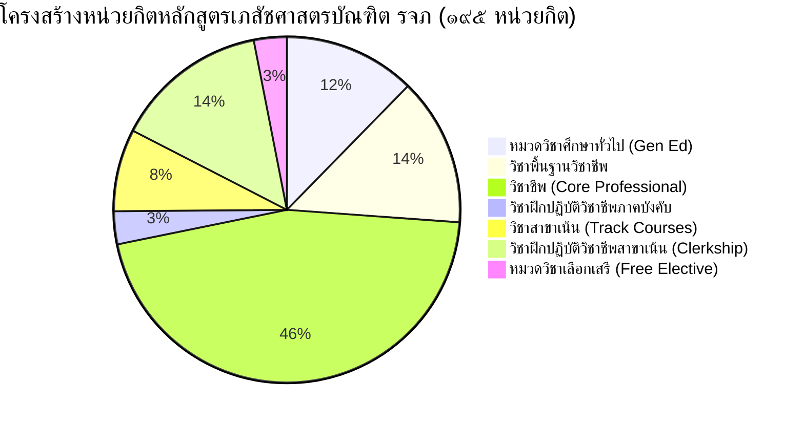

# คู่มือและคลังข้อมูลถาม-ตอบ หลักสูตรเภสัชศาสตรบัณฑิต (หลักสูตร ๖ ปี) (หลักสูตรใหม่ พ.ศ. ๒๕๗๑)
## โครงการจัดตั้งคณะเภสัชศาสตร์ ราชวิทยาลัยจุฬาภรณ์ (รจภ)
*จัดทำขึ้นเพื่อการศึกษา ทำความเข้าใจเชิงลึก และเตรียมความพร้อมในการตอบข้อซักถามในการเสนอสภาราชวิทยาลัยและสภาเภสัชกรรม*

---

## ๑. สรุปสาระสำคัญสำหรับผู้บริหาร (Executive Summary)

* **ชื่อหลักสูตร**: หลักสูตรเภสัชศาสตรบัณฑิต (หลักสูตร ๖ ปี) (หลักสูตรใหม่ พ.ศ. ๒๕๗๑)
* **ชื่อภาษาอังกฤษ**: Doctor of Pharmacy Program (6-Year Program)
* **ชื่อปริญญา**: เภสัชศาสตรบัณฑิต (ภ.บ.) / Doctor of Pharmacy (Pharm.D.)
* **สถานะหลักสูตร**: หลักสูตรใหม่ กำหนดเปิดสอนภาคการศึกษาที่ ๑ ปีการศึกษา ๒๕๗๑
* **สถาบันผู้ผลิต**: โครงการจัดตั้งคณะเภสัชศาสตร์ ราชวิทยาลัยจุฬาภรณ์
* **สถาบันพี่เลี้ยง**: คณะเภสัชศาสตร์ มหาวิทยาลัยมหิดล (ตามเกณฑ์ข้อกำหนดของสภาเภสัชกรรมสำหรับสถาบันเปิดใหม่)
* **จำนวนหน่วยกิตรวม**: **ไม่น้อยกว่า ๑๙๕ หน่วยกิต**
* **รูปแบบการศึกษา**: ระบบทวิภาค ๖ ปี (ภาคเรียนละ ๑๕ สัปดาห์)
* **อัตลักษณ์และจุดเด่นหลัก (Distinctive Identity)**:
  1. บูรณาการศาสตร์ขั้นสูงด้าน **ยาชีววัตถุ (Biopharmaceuticals), วัคซีน (Vaccines) และผลิตภัณฑ์ยาเพื่อการบำบัดรักษาขั้นสูง (Advanced Therapy Medicinal Products: ATMPs)** เช่น เซลล์บำบัด ยีนบำบัด (CAR-T Cell Therapy, Stem Cell)
  2. **เภสัชศาสตร์แม่นยำ (Precision Pharmacy) และเภสัชพันธุศาสตร์ (Pharmacogenomics)** เชื่อมโยงการบริบาลผู้ป่วยเฉพาะบุคคล (Personalized Healthcare)
  3. บูรณาการ **ปัญญาประดิษฐ์ (AI in Healthcare) และวิทยาการข้อมูลสุขภาพ (Health Data Science)** รองรับยุค Digital Health
  4. มุ่งเน้นการรักษาโรคมะเร็งและโรคซับซ้อน สอดรับกับความเชี่ยวชาญระดับตติยภูมิขั้นสูงของโรงพยาบาลจุฬาภรณ์ และศูนย์ไซโคลตรอนและเพทสแกนแห่งชาติ (วิชาเภสัชภัณฑ์รังสี: Radiopharmaceuticals)
* **เป้าหมายแผนรับนักศึกษา**: เริ่มปี ๒๕๗๑ รับ ๓๐ คน/ปี และทยอยขยายเป็น ๔๐ และ ๕๐ คน/ปี บัณฑิตรุ่นแรกสำเร็จการศึกษาปีการศึกษา ๒๕๗๖

---

## ๒. ปรัชญา ปณิธาน วิสัยทัศน์ พันธกิจ และวัตถุประสงค์

### ๒.๑ ปรัชญา (Philosophy)
> **"เป็นเลิศทางเภสัชศาสตร์ ด้านชีวเภสัชภัณฑ์เพื่อทุกชีวิต"**  
> มุ่งผลิตเภสัชกรที่มีสมรรถนะตามมาตรฐานวิชาชีพ พร้อมรับนวัตกรรมยาระดับสากล เป็นคนดี มีความรู้คู่คุณธรรม บูรณาการศาสตร์ทางเภสัชกรรมสู่ความเชี่ยวชาญด้านยาชีววัตถุ วัคซีน และ ATMPs และเทคโนโลยีดิจิทัล ยึดมั่นในหลักจริยธรรมและจิตอาสา พร้อมทักษะการเรียนรู้ตลอดชีวิต เพื่อสร้างสุขภาวะสังคมที่ยั่งยืน

### ๒.๒ ปณิธาน (Determination)
มุ่งผลิตบัณฑิตที่มีความรู้ลึกในวิชาชีพ บูรณาการนวัตกรรมเภสัชศาสตร์ด้านชีวเภสัชภัณฑ์ ด้วยจิตวิญญาณวิชาชีพ คุณธรรม และความรับผิดชอบต่อสังคม สอดคล้องกับพระปณิธานใน ศ.ดร.สมเด็จพระเจ้าน้องนางเธอ เจ้าฟ้าจุฬาภรณวลัยลักษณ์ อัครราชกุมารี กรมพระศรีสวางควัฒน วรขัตติยราชนารี

### ๒.๓ วิสัยทัศน์ (Vision)
หลักสูตรเภสัชศาสตรบัณฑิต (หลักสูตร ๖ ปี) เป็นหลักสูตรที่มีความโดดเด่นด้านชีวเภสัชภัณฑ์ บูรณาการองค์ความรู้ ขับเคลื่อนระบบสุขภาพและอุตสาหกรรมยา เพื่อสนับสนุนนโยบายชาติ สู่การยกระดับคุณภาพชีวิตของประชาชนอย่างยั่งยืน

### ๒.๔ พันธกิจ ๔ ด้าน (Missions)
1. ผลิตบัณฑิตที่มีสมรรถนะตามมาตรฐานวิชาชีพและมีความเชี่ยวชาญเฉพาะด้านชีวเภสัชภัณฑ์และเภสัชภัณฑ์รังสี
2. บ่มเพาะแนวคิดด้านการวิจัยและนวัตกรรมยา บูรณาการปัญญาประดิษฐ์และเทคโนโลยีดิจิทัล
3. ให้บริการวิชาการแก่สังคมด้านยาและสุขภาพ ปลูกฝังจิตอาสาและลดความเหลื่อมล้ำในการเข้าถึงยานวัตกรรม
4. ส่งเสริมการทำนุบำรุงศิลปวัฒนธรรม และบริหารหลักสูตรตามหลักธรรมาภิบาล

### ๒.๕ วัตถุประสงค์ของหลักสูตร (Program Objectives)
1. เป็นเภสัชกรที่มีความรู้ ทักษะ และสมรรถนะตามมาตรฐานวิชาชีพเภสัชกรรม (Core Pharmacy Competencies) ปฏิบัติงานได้ครบวงจร
2. มีสมรรถนะพิเศษด้านยาชีววัตถุ วัคซีน ATMPs และเภสัชภัณฑ์รังสี ทั้งในสายการผลิต วิจัย และบริบาล
3. บูรณาการปัญญาประดิษฐ์ เทคโนโลยีดิจิทัล และการวิเคราะห์ข้อมูลสุขภาพขนาดใหญ่ (Health Big Data)
4. มีทักษะคิดเชิงวิพากษ์ สร้างสรรค์งานวิจัยนวัตกรรมยา และมีทักษะการเรียนรู้ตลอดชีวิต (Lifelong Learning)
5. ยึดมั่นในจรรยาบรรณวิชาชีพ มีจิตสาธารณะ และมุ่งเน้นการเข้าถึงยาที่มีคุณภาพอย่างเท่าเทียม

---

## ๓. ผลลัพธ์การเรียนรู้ระดับหลักสูตร (Program Learning Outcomes: PLOs)

หลักสูตรกำหนดผลลัพธ์การเรียนรู้ ๑๗ ข้อ แบ่งเป็น **Specific PLOs (S-PLO)** ๑๕ ข้อ และ **Generic PLOs (G-PLO)** ๒ ข้อ ตามกรอบ KSEC (Knowledge, Skill, Ethic, Character):

| รหัส PLO | คำอธิบายผลลัพธ์การเรียนรู้ (PLOs) | มิติ KSEC | โดเมนการเรียนรู้ |
| :--- | :--- | :---: | :---: |
| **S-PLO๑** | ประยุกต์ใช้หลักการและทฤษฎีทางเภสัชกรรม เภสัชวิทยา เทคโนโลยีชีวภาพ และวิทยาศาสตร์สุขภาพ เพื่อวิเคราะห์และคาดการณ์ผลการออกฤทธิ์และอาการไม่พึงประสงค์ของยา ผลิตภัณฑ์สุขภาพ รวมถึงยาชีววัตถุ วัคซีน และ ATMPs | ความรู้ (K) | Cognitive (Ap) |
| **S-PLO๒** | วิเคราะห์ความรู้เกี่ยวกับหลักการสำคัญในการผลิต การวิจัยและพัฒนา การควบคุมและประกันคุณภาพ รวมถึงการกระจายยา และการขึ้นทะเบียนยา ผลิตภัณฑ์สุขภาพ รวมถึงยาชีววัตถุ วัคซีน ATMPs และเภสัชภัณฑ์รังสี ตามมาตรฐานที่เป็นปัจจุบัน | ความรู้ (K) | Cognitive (An) |
| **S-PLO๓** | วางแผนการบริบาลทางเภสัชกรรม การจัดการความปลอดภัยจากการใช้ยาชีววัตถุ วัคซีน และ ATMPs ด้วยความรู้ด้านเภสัชบำบัด เภสัชพันธุศาสตร์ และเภสัชศาสตร์แม่นยำ ตามมาตรฐานวิชาชีพ | ทักษะ (S) | Cognitive/Psychomotor |
| **S-PLO๔** | ประยุกต์ใช้ข้อมูลขนาดใหญ่ ความรู้ระบบบริการสุขภาพ นโยบายยา กฎหมาย และความคุ้มค่าของยา ผลิตภัณฑ์สุขภาพ ยาชีววัตถุ วัคซีน และ ATMPs เพื่อการบริหารจัดการตามบริบทองค์กร | ความรู้/ทักษะ | Cognitive (Ap) |
| **S-PLO๕** | เลือกใช้เครื่องมือทางสถิติที่ถูกต้อง รวมทั้งหลักฐานเชิงประจักษ์ เพื่อสนับสนุนการตัดสินใจในการผลิต การควบคุมและประกันคุณภาพ การวิจัยและพัฒนา และการบริบาลทางเภสัชกรรม | ทักษะ (S) | Cognitive/Skill |
| **S-PLO๖** | ประยุกต์ใช้ชีวสารสนเทศ ปัญญาประดิษฐ์ (AI) และเทคโนโลยีข้อมูลขนาดใหญ่ระดับพื้นฐาน เพื่อเพิ่มประสิทธิภาพการออกแบบ การผลิต การวิจัยและพัฒนายา ชีววัตถุ วัคซีน และ ATMPs | ทักษะ (S) | Psychomotor/Cognitive |
| **S-PLO๗** | วิเคราะห์ข้อมูลความปลอดภัยและประสิทธิผลของยา ชีววัตถุ วัคซีน และ ATMPs ด้วยเทคโนโลยีวิทยาศาสตร์ข้อมูล เพื่อการบริหารและพัฒนาระบบยา | ทักษะ (S) | Cognitive (An) |
| **S-PLO๘** | ประเมินความถูกต้องและความเป็นปัจจุบันของหลักฐานทางวิชาการที่เกี่ยวข้องกับเภสัชกรรมบำบัด ยา ผลิตภัณฑ์สุขภาพ ชีววัตถุ วัคซีน และ ATMPs | ความรู้/ทักษะ | Cognitive (E) |
| **S-PLO๙** | นำระเบียบวิธีวิจัยไปพัฒนาเพื่อสร้างนวัตกรรมทางเภสัชศาสตร์ | ทักษะ (S) | Cognitive (Cr) / Skill |
| **S-PLO๑๐** | สื่อสารให้คำแนะนำทางเภสัชศาสตร์อย่างเหมาะสมกับกลุ่มเป้าหมาย โดยให้ความสำคัญกับการรับฟังและการแสดงความเคารพในความเห็นต่าง | ทักษะ (S) | Affective / Skill |
| **S-PLO๑๑** | ดำเนินการด้านการผลิต วิจัยพัฒนา ควบคุมและประกันคุณภาพ และการขึ้นทะเบียนยา ผลิตภัณฑ์สุขภาพ ยาชีววัตถุ วัคซีน ATMPs และเภสัชภัณฑ์รังสี ตามกฎหมายและมาตรฐานสากล | ทักษะ (S) | Psychomotor (P) |
| **S-PLO๑๒** | ให้การบริบาลทางเภสัชกรรม สำหรับผู้ป่วยที่ได้รับยา ผลิตภัณฑ์สุขภาพ ชีววัตถุ วัคซีน และ ATMPs ได้ตามมาตรฐานวิชาชีพและหลักการใช้ยาอย่างสมเหตุผล (RDU) | ทักษะ (S) | Psychomotor (P) |
| **S-PLO๑๓** | ปฏิบัติงานด้านการเฝ้าระวังความปลอดภัยด้านยา (Pharmacovigilance) ที่สอดคล้องกับนโยบายยา ระบบบริการสุขภาพ และการคุ้มครองผู้บริโภค | ทักษะ (S) | Psychomotor (M) |
| **S-PLO๑๔** | ประเมินสถานการณ์ปัญหาทางจริยธรรมและข้อขัดแย้งทางผลประโยชน์ที่เกี่ยวข้องกับการเข้าถึงและการใช้ยา ชีววัตถุ วัคซีน และ ATMPs พร้อมเสนอแนวทางแก้ไขที่ยึดมั่นในความถูกต้องต่อสังคมและผู้ป่วย | จริยธรรม (E) | Affective (V) |
| **G-PLO๑๕** | ดำรงตนและปฏิบัติงานตามกฎหมาย ระเบียบ ข้อบังคับ และจรรยาบรรณวิชาชีพ โดยยึดมั่นในหลักธรรมาภิบาล ความโปร่งใส เกียรติศักดิ์แห่งวิชาชีพ และความรับผิดชอบต่อสาธารณะ | จริยธรรม (E) | Affective (C) |
| **G-PLO๑๖** | ทำงานร่วมกับสหวิชาชีพ (Interprofessional Collaboration) และบริหารจัดการตนเอง มีความยืดหยุ่นในการปรับตัวในสภาพแวดล้อมที่เปลี่ยนแปลง | ลักษณะบุคคล (C) | Affective / Character |
| **S-PLO๑๗** | พัฒนาตนเองและวางแผนการเรียนรู้ตลอดชีวิต (Lifelong Learning) เพื่อก้าวทันความก้าวหน้าด้านยา ชีววัตถุ วัคซีน ATMPs และเทคโนโลยีการแพทย์ที่เปลี่ยนแปลงอย่างรวดเร็ว | ลักษณะบุคคล (C) | Affective / Character |

---

## ๔. โครงสร้างหลักสูตรและสัดส่วนหน่วยกิต (Curriculum Structure)

หลักสูตรกำหนดจำนวนหน่วยกิตรวมตลอดหลักสูตร **ไม่น้อยกว่า ๑๙๕ หน่วยกิต** แบ่งออกเป็น ๓ หมวดวิชา ดังนี้:

### รายละเอียดโครงสร้างหน่วยกิต

| หมวดวิชา | เกณฑ์มาตรฐานหลักสูตร | หน่วยกิตในหลักสูตร รจภ | ร้อยละ |
| :--- | :---: | :---: | :---: |
| **๑. หมวดวิชาศึกษาทั่วไป (General Education)** | ไม่น้อยกว่า ๒๔ | **๒๔** | ๑๒.๓% |
| **๒. หมวดวิชาเฉพาะ (Specialized Courses)** | ไม่น้อยกว่า ๑๖๕ | **๑๖๕** | ๘๔.๖% |
| &nbsp;&nbsp;๒.๑ วิชาพื้นฐานวิชาชีพ | ไม่น้อยกว่า ๒๒ | **๒๗** | ๑๓.๘% |
| &nbsp;&nbsp;๒.๒ วิชาชีพ | ไม่น้อยกว่า ๗๐ | **๘๙** | ๔๕.๖% |
| &nbsp;&nbsp;๒.๓ วิชาฝึกปฏิบัติวิชาชีพภาคบังคับ | ไม่น้อยกว่า ๔ | **๖** (๓๐๐ ชม.) | ๓.๑% |
| &nbsp;&nbsp;๒.๔ วิชาสาขาเน้น (เลือกสายใดสายหนึ่ง) | ไม่น้อยกว่า ๑๕ | **๑๕** | ๗.๗% |
| &nbsp;&nbsp;&nbsp;&nbsp;• สาขาเน้นด้านเภสัชกรรมอุตสาหการ (Industrial Track) | (๑๕) | (๑๕) | - |
| &nbsp;&nbsp;&nbsp;&nbsp;• สาขาเน้นด้านการบริบาลทางเภสัชกรรม (Care Track) | (๑๕) | (๑๕) | - |
| &nbsp;&nbsp;๒.๕ วิชาฝึกปฏิบัติวิชาชีพสาขาเน้น | ไม่น้อยกว่า ๑๖ | **๒๘** (๑,๗๐๐ ชม.) | ๑๔.๔% |
| &nbsp;&nbsp;&nbsp;&nbsp;*(รวมชั่วโมงฝึกปฏิบัติงานตลอดหลักสูตร ๒,๐๐๐ ชั่วโมง)* | *ไม่น้อยกว่า ๒,๐๐๐ ชม.* | *๒,๐๐๐ ชม.* | *ตามเกณฑ์สภาฯ* |
| **๓. หมวดวิชาเลือกเสรี (Free Electives)** | ไม่น้อยกว่า ๖ | **๖** | ๓.๑% |
| **รวมตลอดหลักสูตร** | **ไม่น้อยกว่า ๑๙๕** | **๑๙๕** | **๑๐๐%** |

---

## ๕. ระบบรหัสวิชา (Course Coding System)

รหัสวิชาประกอบด้วยตัวอักษร ๔ ตัว และตัวเลข ๔ หลัก เช่น **`จภภศ ๔๒๐๙`** / **`CHPD 4209`**

1. **อักษรลำดับที่ ๑ - ๒**: `จภ` (CH) = ราชวิทยาลัยจุฬาภรณ์ (Chulabhorn Royal Academy)
2. **อักษรลำดับที่ ๓ - ๔**: `ภศ` (PD) = คณะเภสัชศาสตร์ (Faculty of Pharmacy)
3. **ตัวเลขหลักที่ ๑ (หลักพัน - ชั้นปีที่เรียน)**:
   * `๐` = วิชาศึกษาทั่วไป / วิชาเลือกเสรี
   * `๑` ถึง `๖` = รายวิชาที่จัดสอนในชั้นปีที่ ๑ ถึง ๖
4. **ตัวเลขหลักที่ ๒ (หลักร้อย - กลุ่มวิชา)**:
   * `๐` = กลุ่มวิชาศึกษาทั่วไป / วิชาเลือกเสรี
   * `๑` = กลุ่มวิชาพื้นฐานวิชาชีพ (Basic Professional)
   * `๒` = กลุ่มวิชาด้านเภสัชกรรมอุตสาหการ (Industrial Pharmacy Group)
   * `๓` = กลุ่มวิชาด้านการบริบาลทางเภสัชกรรม (Clinical/Care Pharmacy Group)
   * `๔` = กลุ่มวิชาด้านเภสัชศาสตร์สังคมและการบริหารเภสัชกิจ (Social & Admin Pharmacy)
   * `๕` = กลุ่มวิชาชีพเภสัชกรรม / วิชาฝึกปฏิบัติงานวิชาชีพภาคบังคับ
   * `๖` = กลุ่มวิชาสาขาเน้นด้านเภสัชกรรมอุตสาหการ
   * `๗` = กลุ่มวิชาสาขาเน้นด้านการบริบาลทางเภสัชกรรม
   * `๘` = กลุ่มวิชาฝึกปฏิบัติวิชาชีพด้านเภสัชกรรมอุตสาหการ
   * `๙` = กลุ่มวิชาฝึกปฏิบัติวิชาชีพด้านการบริบาลทางเภสัชกรรม
5. **ตัวเลขหลักที่ ๓ และ ๔ (หลักสิบและหน่วย)**: ลำดับรายวิชาในกลุ่มนั้น ๆ (เริ่มจาก ๐๑)

---

## ๖. แผนการศึกษา ๖ ปี (Study Plan Overview)

### ชั้นปีที่ ๑ (Year 1): ฐานรากวิทยาศาสตร์สุขภาพและทักษะพลเมืองยุคใหม่
* **ภาคเรียนที่ ๑ (๒๐ หน่วยกิต)**: ทักษะพลเมืองดิจิทัล (จภภศ๐๐๐๑), จริยธรรม AI ใน Healthcare (จภภศ๐๐๐๒), ยาสมุนไพรและพฤกษบำบัด (จภภศ๑๑๐๑), เภสัชกรรมเชิงฟิสิกส์ (จภภศ๑๑๐๒), กายวิภาคและสรีรวิทยามนุษย์ ๑ (จภภศ๑๑๐๕), เภสัชชีวเคมีและชีววิทยาโมเลกุล (จภภศ๑๑๐๗)
* **ภาคเรียนที่ ๒ (๑๙ หน่วยกิต)**: ทักษะวิจัยและวิทยาการข้อมูล (จภภศ๐๐๐๓), กายวิภาคและสรีรวิทยามนุษย์ ๒ (จภภศ๑๑๐๖), จุลชีววิทยาทางเภสัชกรรม (จภภศ๑๑๐๔), เภสัชเคมีวิเคราะห์ (จภภศ๑๑๐๓), ภูมิคุ้มกันวิทยา (จภภศ๑๑๐๘), ภาษาอังกฤษวิชาชีพ (จภภศ๐๐๑๒)

### ชั้นปีที่ ๒ (Year 2): วิทยาศาสตร์เภสัชกรรมขั้นพื้นฐานและการบริบาลเบื้องต้น
* **ภาคเรียนที่ ๑ (๑๘ หน่วยกิต)**: หลักการเคมีของยา (จภภศ๒๒๐๑), การวิเคราะห์เครื่องมือขั้นสูง (จภภศ๒๒๐๒), รูปแบบยา: สารละลายและคอลลอยด์ (จภภศ๒๒๐๓), หลักการเภสัชวิทยา (จภภศ๒๑๐๙), เคมีคลินิกพื้นฐาน (จภภศ๒๑๑๐), การตรวจร่างกาย (จภภศ๒๓๐๒), หลักชีวเภสัชกรรมและ PK (จภภศ๒๓๐๓)
* **ภาคเรียนที่ ๒ (๑๙ หน่วยกิต)**: รูปแบบยา: ยาน้ำแขวนตะกอน อิมัลชัน ยากึ่งแข็ง (จภภศ๒๒๐๔), การส่งมอบและให้คำปรึกษาด้านยา (จภภศ๒๓๐๑), บูรณาการโรคระบบกล้ามเนื้อ/กระดูก/ผิวหนัง/ตา (จภภศ๒๓๐๔), บูรณาการโรคติดเชื้อและทางเดินหายใจ (จภภศ๒๓๐๕), นโยบายและระบบสุขภาพ (จภภศ๒๔๐๑), วิชาเลือกศึกษาทั่วไป

### ชั้นปีที่ ๓ (Year 3): บูรณาการเภสัชบำบัดและระบบการผลิตยา
* **ภาคเรียนที่ ๑ (๑๘ หน่วยกิต)**: รูปแบบยา: ยาเม็ดและของแข็ง (จภภศ๓๒๐๕), เทคโนโลยีชีวภาพทางเภสัชกรรม (จภภศ๓๒๐๗), ระบบคุณภาพทางเภสัชกรรม (จภภศ๓๒๐๘), บูรณาการโรคระบบทางเดินอาหารและตับ (จภภศ๓๓๐๖), บูรณาการโรคต่อมไร้ท่อและระบบสืบพันธุ์ (จภภศ๓๓๐๗), ระเบียบวิธีวิจัย (จภภศ๓๔๐๒)
* **ภาคเรียนที่ ๒ (๑๘ หน่วยกิต)**: รูปแบบยา: ยาปราศจากเชื้อและยาสูดพ่น (จภภศ๓๒๐๖), บูรณาการโรคไตและทางเดินปัสสาวะ (จภภศ๓๓๐๘), บูรณาการโรคหัวใจและหลอดเลือด ๑ (จภภศ๓๓๐๙), นิติเภสัชศาสตร์และจริยธรรม (จภภศ๓๔๐๓), การประเมินบนหลักฐานเชิงประจักษ์ (EBM) (จภภศ๓๔๐๔), วิชาศึกษาทั่วไป

### ชั้นปีที่ ๔ (Year 4): ยานวัตกรรมขั้นสูง (ATMPs), เภสัชศาสตร์แม่นยำ และวิทยาการข้อมูล
* **ภาคเรียนที่ ๑ (๑๙ หน่วยกิต)**: 
  * **ชีววัตถุ วัคซีน และ ATMPs (จภภศ๔๒๐๙ - ๔ หน่วยกิต)** *(หัวใจหลัก)*
  * วิทยาการข้อมูลประยุกต์และนวัตกรรมยา (จภภศ๔๒๑๒ - ๓ หน่วยกิต)
  * บูรณาการโรคหัวใจและหลอดเลือด ๒ (จภภศ๔๓๑๐)
  * บูรณาการโรคระบบประสาทส่วนกลาง ๑ (จภภศ๔๓๑๑)
  * เภสัชบำบัดโรคที่พบบ่อยในร้านยา (จภภศ๔๓๑๓)
  * เภสัชเศรษฐศาสตร์ (จภภศ๔๔๐๕)
* **ภาคเรียนที่ ๒ (๑๙ หน่วยกิต)**:
  * การกำกับดูแลยาและชีววัตถุ (จภภศ๔๒๑๐), เซลล์ต้นกำเนิดและวิศวกรรมเนื้อเยื่อ (จภภศ๔๒๑๑)
  * **บูรณาการโรคระบบเลือดและมะเร็ง ๑ (จภภศ๔๓๑๔ - ๓ หน่วยกิต)**
  * **เภสัชศาสตร์แม่นยำ (Precision Pharmacy - จภภศ๔๓๑๖)**
  * พิษวิทยาคลินิก (จภภศ๔๓๑๕), การเฝ้าระวังความปลอดภัยยา (จภภศ๔๔๐๖)
  * สมรรถนะวิชาชีพเภสัชกรรมตามผลลัพธ์การเรียนรู้ ๑ (จภภศ๔๕๐๑) *(Pre-requisite ก่อนออกฝึกงาน)*

### ชั้นปีที่ ๕ (Year 5): วิชาสาขาเน้น, โครงงานวิจัยพิเศษ และการฝึกงานภาคบังคับ
* **ภาคเรียนที่ ๑ (๑๖ หน่วยกิต)**:
  * การจัดการคุณภาพและความเสี่ยง (จภภศ๕๕๐๒), สหวิชาชีพเพื่อการดูแลผู้ป่วย (จภภศ๕๕๐๓), โครงร่างวิจัย (จภภศ๕๖๐๓ หรือ จภภศ๕๗๐๓ - ๒ หน่วยกิต)
  * *สายอุตสาหการ*: เภสัชอุตสาหกรรม (จภภศ๕๖๐๑), การผลิตและระบบคุณภาพชีววัตถุ (จภภศ๕๖๐๒)
  * *สายบริบาล*: เภสัชบำบัดในประชากรกลุ่มพิเศษ (จภภศ๕๗๐๑), บูรณาการโรคมะเร็งขั้นสูง ๒ (จภภศ๕๗๐๒)
  * วิชาเลือกเสรี ๒ วิชา (๔ หน่วยกิต)
* **ภาคเรียนที่ ๒ (๑๔ หน่วยกิต)**:
  * โครงงานพิเศษวิจัย (Special Project - ๖ หน่วยกิต)
  * สมรรถนะวิชาชีพตามผลลัพธ์การเรียนรู้ ๒ (จภภศ๕๖๐๕ หรือ จภภศ๕๗๐๕ - ๒ หน่วยกิต)
  * **ฝึกปฏิบัติงานวิชาชีพภาคบังคับ (๖ หน่วยกิต / ๓๐๐ ชั่วโมง)**:
    * ฝึกปฏิบัติงานในโรงพยาบาล (จภภศ๕๕๐๔ - ๓ หน่วยกิต)
    * ฝึกปฏิบัติงานในร้านยาชุมชน (จภภศ๕๕๐๕ - ๓ หน่วยกิต)

### ชั้นปีที่ ๖ (Year 6): การฝึกปฏิบัติงานวิชาชีพสาขาเน้นเต็มรูปแบบ (Clerkship ๒๘ หน่วยกิต)
* แบ่งการฝึกเป็น **๗ ผลัด (Rotation ละ ๔ หน่วยกิต / ไม่น้อยกว่า ๖ สัปดาห์ / ๒๔๐-๒๕๐ ชั่วโมงต่อผลัด รวม ๑,๗๐๐ ชั่วโมง)**
* **สายอุตสาหการ (Industrial Track)**: ฝึกการผลิตยาชีววัตถุและยาแผนปัจจุบัน, การควบคุมคุณภาพ (QC), การประกันคุณภาพ (QA), การวิจัยและพัฒนาสูตรตำรับ (R&D), การขึ้นทะเบียนยาและเอกสารกำกับสากล
* **สายการบริบาล (Pharmaceutical Care Track)**: การบริบาลผู้ป่วยนอก (OPD), การบริบาลผู้ป่วยใน (IPD), การจัดการระบบยาใน รพ., บริบาลผู้ป่วยมะเร็งและยาเคมีบำบัด/ชีววัตถุ (Oncology Care ณ รพ.จุฬาภรณ์), เภสัชกรรมปฐมภูมิ, เภสัชกรรมชุมชนขั้นสูง, การเฝ้าระวังความปลอดภัยยา

---

## ๗. คณาจารย์ประจำหลักสูตร อาจารย์ผู้สอน และอาจารย์พิเศษ (ชื่อเต็มยศ)

### ๗.๑ อาจารย์ประจำหลักสูตร (๑๐ คน)
*(เครื่องหมาย ★ หมายถึง เป็นอาจารย์ผู้รับผิดชอบหลักสูตร ๕ ท่าน)*

1. **รองศาสตราจารย์ ดร.เภสัชกรหญิงจุฑามณี สุทธิสีสังข์** ★ (ผู้รับผิดชอบหลักสูตร / เภสัชวิทยาและนโยบายยา)
   * คุณวุฒิ: ภ.บ. (ม.มหิดล), วท.ม. (เภสัชวิทยา, ม.มหิดล), ปร.ด. (เภสัชวิทยา, ม.มหิดล)
   * ภาระงานสอน: `จภภศ๒๑๐๙` หลักการทางเภสัชวิทยา, `จภภศ๔๓๑๑` เภสัชบำบัดระบบประสาท ๑
2. **ศาสตราจารย์ ดร.เภสัชกรไพบูลย์ จึงสุวดี** ★ (ผู้รับผิดชอบหลักสูตร / มะเร็งวิทยาและ CAR-T Cell)
   * คุณวุฒิ: ภ.บ. (ม.เชียงใหม่), วท.ม. (เภสัชกรรมคลินิก, ม.มหิดล), Ph.D. in Pharmacy (Univ. of Vienna, Austria)
   * ภาระงานสอน (๑๙ วิชา): `จภภศ๑๑๐๘`, `จภภศ๒๑๐๙`, `จภภศ๒๓๐๑-๒๓๐๕`, `จภภศ๓๓๐๖-๓๓๐๙`, `จภภศ๔๓๑๔`, `จภภศ๕๗๐๒` (CAR-T) ฯลฯ
3. **รองศาสตราจารย์ ดร.เภสัชกรหญิงนริศา คำแก่น** ★ (ผู้รับผิดชอบหลักสูตร / สมุนไพรและพฤกษบำบัด)
   * คุณวุฒิ: วุฒิบัตร อ.ภ. เภสัชกรรมสมุนไพร, F.A.C.P., Ph.D. in Biomedical Sciences (Charles Sturt Univ.), ภ.ม. จุฬาฯ, ภ.บ. ม.สงขลานครินทร์
   * ภาระงานสอน (๙ วิชา): `จภภศ๑๑๐๑`, `จภภศ๑๑๐๓`, `จภภศ๒๑๑๐`, `จภภศ๒๒๐๑`, `จภภศ๓๔๐๓`, `จภภศ๕๖๐๓-๕๖๐๕`
4. **อาจารย์ ดร.เภสัชกรหญิงพิรุณรัตน์ เดชบำรุง** ★ (ผู้รับผิดชอบหลักสูตร / เภสัชกรรมนาโนและ LNPs)
   * คุณวุฒิ: Ph.D. in Chemistry Nanoscience & Tech (CAS จีน), ภ.ม. จุฬาฯ, ภ.บ. (เกียรตินิยม จุฬาฯ)
   * ภาระงานสอน (๙ วิชา): `จภภศ๑๑๐๒-๑๑๐๓`, `จภภศ๒๒๐๒-๒๒๐๔`, `จภภศ๓๒๐๕-๓๒๐๖`, `จภภศ๔๒๑๐`, `จภภศ๕๖๐๒`
5. **อาจารย์ ดร.เภสัชกรหญิงปัฐวิกา เลิศปฏิภานพงษ์** ★ (ผู้รับผิดชอบหลักสูตร / เภสัชวิทยาโมเลกุล)
   * คุณวุฒิ: Ph.D. & M.Sc. in Veterinary Biomedical Sciences (Seoul National Univ., เกาหลีใต้), ภ.บ. (บริบาล) มศว
   * ภาระงานสอน (๘ วิชา): `จภภศ๑๑๐๔`, `จภภศ๑๑๐๗-๑๑๐๘`, `จภภศ๒๑๐๙-๒๑๑๐`, `จภภศ๓๓๐๗-๓๓๐๘`, `จภภศ๔๓๑๔`
6. **อาจารย์ ดร.นิพิฐพนธ์ ศรีไม้**
   * คุณวุฒิ: Ph.D. & M.Sc. in Physiology (ม.มหิดล), วท.บ. ชีววิทยา (ม.นเรศวร)
   * ภาระงานสอน (๕ วิชา): `จภภศ๑๑๐๔-๑๑๐๗`, `จภภศ๒๓๐๒`
7. **อาจารย์ ดร.สิริอร อักษรทอง**
   * คุณวุฒิ: Ph.D. in Experimental Surgery (McGill Univ., แคนาดา), M.Sc. in Physiology (ม.มหิดล), วท.บ. ชีววิทยา เกียรตินิยมอันดับ ๑ (ม.อ.)
   * ภาระงานสอน (๗ วิชา): `จภภศ๑๑๐๔-๑๑๐๗`, `จภภศ๒๑๐๙`, `จภภศ๒๓๐๔`, `จภภศ๓๓๐๗`
8. **อาจารย์ ดร.เภสัชกรหญิงประภัสสรา พงศ์พันธุ์พิศาล**
   * คุณวุฒิ: ปร.ด. เภสัชศาสตร์สังคมและบริหาร (ม.มหิดล), วท.ม. (นิด้า), ภ.ม. บริบาล (จุฬาฯ), ภ.บ. (ม.มหิดล)
   * ภาระงานสอน (๖ วิชา): `จภภศ๒๔๐๑`, `จภภศ๓๔๐๒-๓๔๐๔`, `จภภศ๔๔๐๕-๔๔๐๖`
9. **อาจารย์ ดร.เภสัชกรวัชระ กาญจนกวินกุล**
   * คุณวุฒิ: Ph.D. วิจัยและพัฒนาเภสัชภัณฑ์ (ม.ขอนแก่น), ภ.บ. เภสัชศาสตร์ (ม.ขอนแก่น)
   * ภาระงานสอน (๘ วิชา): `จภภศ๒๒๐๒`, `จภภศ๓๒๐๕`, `จภภศ๓๒๐๘`, `จภภศ๔๒๑๐`, `จภภศ๔๒๑๒`, `จภภศ๔๕๐๑`, `จภภศ๕๖๐๑`, `จภภศ๕๖๐๕`
10. **อาจารย์ ดร.เภสัชกรหญิงฐิติพร รองทอง**
    * คุณวุฒิ: Ph.D. วิจัยและพัฒนาเภสัชภัณฑ์ (ม.ขอนแก่น), ภ.บ. เภสัชศาสตร์ (ม.ขอนแก่น)
    * ภาระงานสอน (๘ วิชา): `จภภศ๒๒๐๒`, `จภภศ๓๒๐๕`, `จภภศ๓๒๐๘`, `จภภศ๔๒๑๐`, `จภภศ๔๒๑๒`, `จภภศ๔๕๐๑`, `จภภศ๕๖๐๑`, `จภภศ๕๖๐๕`

---

### ๗.๒ อาจารย์ผู้สอน (๑ คน)
* **อาจารย์ ดร.เภสัชกรสัญญา หกพุดซา**
  * คุณวุฒิ: Ph.D. in Physical Biochemistry (Univ. of Nottingham, UK), ภ.บ. (จุฬาฯ)
  * ภาระงานสอน (๘ วิชา): `จภภศ๑๑๐๒-๑๑๐๓`, `จภภศ๒๒๐๒-๒๒๐๔`, `จภภศ๓๒๐๕-๓๒๐๖`, `จภภศ๓๒๐๘`, `จภภศ๕๖๐๑`

---

### ๗.๓ อาจารย์พิเศษ (๑๗ คน)
1. **ศาสตราจารย์ ดร.เภสัชกรหญิงกนกวรรณ จารุกำจร**
2. **ศาสตราจารย์ ดร.เภสัชกรบุญชู ศรีตุลารักษ์**
3. **รองศาสตราจารย์ ดร.เภสัชกรกิตติศักดิ์ ศรีภา**
4. **รองศาสตราจารย์ เภสัชกรธนรัตน์ สรวลเสน่ห์**
5. **รองศาสตราจารย์ ดร.เภสัชกรหญิงผกาทิพย์ รื่นระเริงศักดิ์**
6. **รองศาสตราจารย์ ดร.เภสัชกรมนตรี จาตุรันต์ภิญโญ**
7. **รองศาสตราจารย์ ดร.เภสัชกรหญิงวรัญญา จตุพรประเสริฐ**
8. **รองศาสตราจารย์ ดร.เภสัชกรหญิงวิลาสินี หิรัญพานิช ซาโตะ**
9. **รองศาสตราจารย์ ดร.เภสัชกรหญิงวีรวรรณ อุชายภิชาติ**
10. **รองศาสตราจารย์ ดร.เภสัชกรหญิงสุพรรณิการ์ ถวิลหวัง**
11. **รองศาสตราจารย์ ดร.เภสัชกรหญิงสุวิมล ยี่ภู่**
12. **รองศาสตราจารย์ ดร.เภสัชกรหญิงอุษา ฉายเกล็ดแก้ว**
13. **ผู้ช่วยศาสตราจารย์ เภสัชกรหญิงเจนนิษฐ์ มีนวัฒนา**
14. **ผู้ช่วยศาสตราจารย์ ดร.เภสัชกรจตุรงค์ ประเทืองเดชกุล**
15. **ผู้ช่วยศาสตราจารย์ ดร.เภสัชกรหญิงวรวรรณ กิจผาติ**
16. **อาจารย์ ดร.เภสัชกรหญิงสลินทิพย์ จารุสินธนาการ**
17. **อาจารย์ ดร.เภสัชกรพงศธร เพียบเพียร**

---

## ๘. แผนการรับนักศึกษา งบประมาณ และเกณฑ์การสำเร็จการศึกษา

### ๘.๑ แผนการรับนักศึกษาในระยะ ๗ ปี
| ปีการศึกษา | ๒๕๗๑ | ๒๕๗๒ | ๒๕๗๓ | ๒๕๗๔ | ๒๕๗๕ | ๒๕๗๖ | ๒๕๗๗ |
| :--- | :---: | :---: | :---: | :---: | :---: | :---: | :---: |
| จำนวนรับเข้าปี ๑ | **๓๐** | **๓๐** | **๓๐** | **๔๐** | **๔๐** | **๔๐** | **๕๐** |
| รวมนักศึกษาทุกชั้นปี | ๓๐ | ๖๐ | ๙๐ | ๑๓๐ | ๑๗๐ | ๒๑๐ | ๒๓๐ |
| บัณฑิตที่จบการศึกษา | - | - | - | - | - | **๓๐** | **๓๐** |

### ๘.๒ คุณสมบัติและการคัดเลือกผู้เข้าศึกษา
1. สำเร็จการศึกษาระดับมัธยมศึกษาตอนปลาย (ม.๖) สายวิทยาศาสตร์-คณิตศาสตร์ หรือเทียบเท่า
2. ผ่านระบบการคัดเลือก ๔ รูปแบบ:
   * TCAS รอบคัดเลือกโดยตรง (Portfolio/ความสามารถพิเศษ)
   * ระบบโควตา (รวมโควตากลุ่มโรงเรียนวิทยาศาสตร์จุฬาภรณราชวิทยาลัย)
   * ระบบรับตรงร่วมกัน / กสพท. / ทปอ.
   * วิธีการอื่นตามประกาศราชวิทยาลัยจุฬาภรณ์

### ๘.๓ เกณฑ์การสำเร็จการศึกษา
1. ศึกษารายวิชาครบถ้วนตามโครงสร้างหลักสูตรไม่น้อยกว่า **๑๙๕ หน่วยกิต** ภายในระยะเวลาไม่ต่ำกว่า ๑๐ ภาคการศึกษาปกติ และไม่เกิน ๒๔ ภาคการศึกษา
2. มีแต้มเฉลี่ยสะสมรวม (GPAX) และแต้มเฉลี่ยหมวดวิชาเฉพาะ **ไม่ต่ำกว่า ๒.๐๐**
3. ได้รับผลการประเมินระดับ **S (Satisfactory)** ในทุกรายวิชาฝึกปฏิบัติงานวิชาชีพ
4. **มีชั่วโมงฝึกปฏิบัติงานวิชาชีพรวมไม่น้อยกว่า ๒,๐๐๐ ชั่วโมง** ตามเกณฑ์ประกาศสภาเภสัชกรรม ที่ ๖๕/๒๕๖๑
5. ผ่านเกณฑ์มาตรฐานการทดสอบความรู้ความสามารถทางภาษาอังกฤษและทักษะเทคโนโลยีสารสนเทศของราชวิทยาลัยจุฬาภรณ์

---

## ๙. คลังคำถาม-คำตอบสำคัญ สำหรับการเสนอสภาราชวิทยาลัย (Q&A Cheat Sheet)

### หมวด ก: ความจำเป็นเชิงยุทธศาสตร์และเอกลักษณ์หลักสูตร

> **ถาม ๑: ทำไมราชวิทยาลัยจุฬาภรณ์จึงต้องเปิดคณะเภสัชศาสตร์และหลักสูตรเภสัชศาสตรบัณฑิตในเวลานี้ มีความซ้ำซ้อนกับมหาวิทยาลัยอื่นหรือไม่?**  
> **ตอบ:**  
> ไม่ซ้ำซ้อนและมีความจำเป็นเร่งด่วนใน ๓ ประเด็นยุทธศาสตร์:
> 1. **การเติมเต็มช่องว่างด้านนวัตกรรมขั้นสูงของประเทศ**: หลักสูตรเภสัชศาสตร์ในปัจจุบันส่วนใหญ่ยังเน้นยาเคมีดั้งเดิม แต่หลักสูตร รจภ ถูกออกแบบให้มีจุดเน้นเฉพาะด้าน **ยาชีววัตถุ วัคซีน และ ATMPs (Cell & Gene Therapy)** ตลอดจน **เภสัชศาสตร์แม่นยำ (Precision Pharmacy)** ซึ่งเป็นอุตสาหกรรมเป้าหมายใหม่ (New S-Curve) และประเทศไทยยังขาดแคลนเภสัชกรผู้เชี่ยวชาญด้านนี้อย่างมาก
> 2. **ตอบสนองพระปณิธานและจุดแข็งของ รจภ**: สนับสนุนพันธกิจของโรงพยาบาลจุฬาภรณ์ในการรักษาโรคมะเร็ง โรคซับซ้อน และศูนย์ไซโคลตรอนและเพทสแกนแห่งชาติ ซึ่งต้องการเภสัชกรที่มีความรู้ลึกซึ้งด้านเภสัชภัณฑ์รังสี ยาชีวบำบัด และการดูแลรักษาเฉพาะบุคคล
> 3. **วิกฤตกำลังคนในระบบสาธารณสุข**: ข้อมูลจากสภาเภสัชกรรม (มิ.ย. ๒๕๖๗) ระบุว่าไทยยังมีเภสัชกรในระบบบริการจริงเพียง ๒๔,๐๐๐ คน ขาดแคลนกว่าเป้าหมาย ๑๐,๐๐๐ คน โดยเฉพาะบุคลากรที่มีสมรรถนะเทคโนโลยีสุขภาพดิจิทัล

> **ถาม ๒: คำว่า "ATMPs" ในหลักสูตรนี้คืออะไร และนักศึกษาจะได้เรียนอะไรบ้าง?**  
> **ตอบ:**  
> ATMPs ย่อมาจาก **Advanced Therapy Medicinal Products** หรือผลิตภัณฑ์ยาเพื่อการบำบัดรักษาขั้นสูง ได้แก่:
> * ยีนบำบัด (Gene Therapy)
> * เซลล์บำบัด (Cell Therapy เช่น CAR-T cells)
> * วิศวกรรมเนื้อเยื่อและการแพทย์ฟื้นฟู (Tissue Engineering & Regenerative Medicine)  
> ในหลักสูตร รจภ มีรายวิชาเฉพาะ เช่น **จภภศ๔๒๐๙ ชีววัตถุ วัคซีน และ ATMPs**, **จภภศ๔๒๑๐ การกำกับดูแลยาและชีววัตถุ**, **จภภศ๔๒๑๑ เซลล์ต้นกำเนิดและวิศวกรรมเนื้อเยื่อ**, **จภภศ๕๖๐๒ การผลิตและระบบคุณภาพชีววัตถุ** ทำให้นักศึกษาได้เรียนรู้ตั้งแต่การเพาะเลี้ยงเซลล์ กระบวนการ upstream/downstream, การควบคุมคุณภาพปลอดเชื้อขั้นสูง, จนถึงการขึ้นทะเบียนและการบริบาลทางคลินิก

> **ถาม ๓: ความพร้อมด้านสถาบันพี่เลี้ยง (Mentoring Institution) เป็นอย่างไร?**  
> **ตอบ:**  
> หลักสูตรได้ลงนามความร่วมมือและมี **คณะเภสัชศาสตร์ มหาวิทยาลัยมหิดล** ซึ่งเป็นสถาบันการศึกษาเภสัชศาสตร์ชั้นนำระดับประเทศและนานาชาติ เป็นสถาบันพี่เลี้ยงตามประกาศเกณฑ์ของสภาเภสัชกรรม ที่ ๗๓/๒๕๖๘ โดยอาจารย์ผู้ทรงคุณวุฒิจาก ม.มหิดล จะร่วมให้คำแนะนำในการบริหารหลักสูตร กำกับระบบคุณภาพ ร่วมสอนในรายวิชาสำคัญ และเป็นแหล่งฝึกปฏิบัติงาน

---

### หมวด ข: โครงสร้างหลักสูตรและการจัดการเรียนการสอน

> **ถาม ๔: จำนวนหน่วยกิต ๑๙๕ หน่วยกิต สอดคล้องกับเกณฑ์มาตรฐานของกระทรวง อว. และสภาเภสัชกรรมหรือไม่?**  
> **ตอบ:**  
> สอดคล้องและถูกต้องครบถ้วน:
> * เกณฑ์ อว. พ.ศ. ๒๕๖๕ กำหนดหลักสูตรปริญญาตรี (๖ ปี) ไม่น้อยกว่า ๑๘๐ หน่วยกิต
> * ประกาศสภาเภสัชกรรมกำหนดไม่น้อยกว่า ๑๙๕ หน่วยกิต
> * หลักสูตร รจภ จัดให้มี **๑๙๕ หน่วยกิต** พอดี โดยแบ่งสัดส่วนหมวดศึกษาทั่วไป ๒๔ หน่วยกิต, หมวดวิชาเฉพาะ ๑๖๕ หน่วยกิต (พื้นฐาน ๒๗ + วิชาชีพ ๘๙ + บังคับฝึกงาน ๖ + วิชาสาขาเน้น ๑๕ + ฝึกงานสาขาเน้น ๒๘) และเลือกเสรี ๖ หน่วยกิต มีการจัดสมดุลภาระการเรียนไม่เกิน ๑๙-๒๐ หน่วยกิตต่อภาคการศึกษา

> **ถาม ๕: การฝึกงาน ๒,๐๐๐ ชั่วโมง แบ่งการจัดการอย่างไร เพื่อให้มั่นใจว่านักศึกษาจะได้ฝึกครบตามเกณฑ์?**  
> **ตอบ:**  
> แบ่งออกเป็น ๒ ช่วงชัดเจน:
> 1. **ชั้นปีที่ ๕ ภาคการศึกษาที่ ๒**: วิชาฝึกปฏิบัติวิชาชีพภาคบังคับ **๖ หน่วยกิต (๓๐๐ ชั่วโมง)** ในโรงพยาบาล (๑๕๐ ชม.) และร้านยาชุมชน (๑๕๐ ชม.) เพื่อเตรียมความพร้อมพื้นฐาน
> 2. **ชั้นปีที่ ๖ ทั้งปีการศึกษา**: วิชาฝึกปฏิบัติงานวิชาชีพสาขาเน้น **๒๘ หน่วยกิต (๑,๗๐๐ ชั่วโมง)** แบ่งเป็น ๗ ผลัด ผลัดละไม่น้อยกว่า ๒๔๐-๒๕๐ ชั่วโมง (๖ สัปดาห์/ผลัด) ในแหล่งฝึกมาตรฐานที่สภาเภสัชกรรมรับรอง เช่น โรงพยาบาลจุฬาภรณ์, โรงพยาบาลศูนย์/ทั่วไป, โรงงานผลิตยาชีววัตถุ, องค์การเภสัชกรรม, สถาบันวิจัยจุฬาภรณ์, และบริษัทชีวเภสัชภัณฑ์ชั้นนำ  
> *รวมเวลาฝึกปฏิบัติงานตลอดหลักสูตร = ๓๐๐ + ๑,๗๐๐ = ๒,๐๐๐ ชั่วโมงครบถ้วน ๑๐๐%*

> **ถาม ๖: นักศึกษาจะเลือกแยกสาย (Track) ในชั้นปีใด และมีสายอะไรบ้าง?**  
> **ตอบ:**  
> นักศึกษาจะเริ่มเลือกสาขาเน้นในช่วง **ปลายชั้นปีที่ ๔ เพื่อเข้าสู่การเรียนวิชาสาขาเน้นในชั้นปีที่ ๕ และฝึกงานในชั้นปีที่ ๖** มี ๒ สาขาเน้นให้เลือก:
> 1. **ด้านเภสัชกรรมอุตสาหการ (Industrial Pharmacy)**: เน้นการผลิต วิจัยและพัฒนา QC/QA สำหรับยาชีววัตถุ วัคซีน และเคมียา
> 2. **ด้านการบริบาลทางเภสัชกรรม (Pharmaceutical Care)**: เน้นการบริบาลทางคลินิก เภสัชบำบัดโรคมะเร็ง เภสัชศาสตร์แม่นยำ และระบบยาในสถานพยาบาล

---

### หมวด ค: คุณภาพอาจารย์ แหล่งฝึก และสิ่งสนับสนุนการเรียนรู้

> **ถาม ๗: คณาจารย์ผู้รับผิดชอบหลักสูตร ๕ ท่าน มีคุณสมบัติถูกต้องตามเกณฑ์หรือไม่?**  
> **ตอบ:**  
> มีคุณสมบัติถูกต้องครบถ้วน ๑๐๐% ตามเกณฑ์มาตรฐานหลักสูตร พ.ศ. ๒๕๖๕ และเกณฑ์สภาเภสัชกรรม:
> * ทุกท่านสำเร็จการศึกษาระดับปริญญาเอก (Ph.D./ปร.ด.) หรือวุฒิบัตรผู้เชี่ยวชาญเฉพาะทาง
> * มีตำแหน่งทางวิชาการระดับ ศาสตราจารย์ (๑ ท่าน), รองศาสตราจารย์ (๒ ท่าน), และอาจารย์ ดร. (๒ ท่าน)
> * มีใบอนุญาตประกอบวิชาชีพเภสัชกรรม และสำเร็จการศึกษาด้านเภสัชศาสตร์
> * มีผลงานวิจัยที่ตีพิมพ์ในวารสารวิชาการระดับนานาชาติ (Scopus/Web of Science Q1/Q2) ย้อนหลัง ๕ ปีอย่างต่อเนื่อง

> **ถาม ๘: บัณฑิตที่สำเร็จการศึกษาจะสามารถสอบใบอนุญาตประกอบวิชาชีพเภสัชกรรมได้หรือไม่?**  
> **ตอบ:**  
> สามารถสอบได้ตามขั้นตอนปกติ เนื่องจาก:
> 1. โครงสร้างหลักสูตรและรายวิชาได้รับการออกแบบให้ครอบคลุมสมรรถนะวิชาชีพตามประกาศสภาเภสัชกรรม ที่ ๒๘/๒๕๖๘ และ ๖๕/๒๕๖๑ ครบถ้วน
> 2. มีสถาบันพี่เลี้ยง (คณะเภสัชศาสตร์ ม.มหิดล) กำกับดูแล
> 3. มีชั่วโมงฝึกงานครบ ๒,๐๐๐ ชั่วโมงในแหล่งฝึกที่ได้รับการรับรอง
> 4. เมื่อสภาราชวิทยาลัยอนุมัติ จะเสนอสภาเภสัชกรรมเพื่อตรวจประเมินและให้การรับรองสถาบันผลิตบัณฑิตต่อไป

---
*เอกสารนี้รวบรวมและวิเคราะห์ข้อมูลจากเล่มหลักสูตรเภสัชศาสตรบัณฑิต โครงการจัดตั้งคณะเภสัชศาสตร์ ราชวิทยาลัยจุฬาภรณ์ (ไฟล์: 20261030_เล่มหลักสูตรเภสัชศาสตรบัณฑิต รจภ ระหว่างรอ-เสนอสภาราชวิทยาลัย.docx)*
